# Passive Reconnaissance & OSINT — Part 1

---

## Table of Contents

1. [Introduction and Learning Objectives](#1-introduction-and-learning-objectives)
2. [Start with Scope and Program Rules](#2-start-with-scope-and-program-rules)
3. [What Is Passive Reconnaissance?](#3-what-is-passive-reconnaissance)
4. [Think in Information, Not Tools](#4-think-in-information-not-tools)
5. [How Search Engines Work](#5-how-search-engines-work)
6. [Search Operators for Targeted Research](#6-search-operators-for-targeted-research)
7. [What Should You Search For?](#7-what-should-you-search-for)
8. [Build Queries as Hypotheses](#8-build-queries-as-hypotheses)
9. [Use More Than One Search Engine](#9-use-more-than-one-search-engine)
10. [Validate Results: Leads Are Not Findings](#10-validate-results-leads-are-not-findings)
11. [Document Reconnaissance as You Work](#11-document-reconnaissance-as-you-work)
12. [Public Documents and File Discovery](#12-public-documents-and-file-discovery)
13. [Understanding Document Metadata](#13-understanding-document-metadata)
14. [Using Metadata Tools and Automation](#14-using-metadata-tools-and-automation)
15. [Connect the Clues into an Intelligence Picture](#15-connect-the-clues-into-an-intelligence-picture)
16. [Practical Passive Reconnaissance Workflow](#16-practical-passive-reconnaissance-workflow)
17. [Field Notes Template](#17-field-notes-template)
18. [Final Checklist and Key Takeaways](#18-final-checklist-and-key-takeaways)

---

## 1. Introduction and Learning Objectives

يُعد **الاستطلاع السلبي (Passive Reconnaissance)** أول نشاط عملي لجمع المعلومات في هذا الدليل، ويأتي بعد مرحلة التخطيط وفهم منهجية اختبار الاختراق.

الهدف هو تكوين صورة أولية عن الهدف بالاعتماد على المعلومات المتاحة للعامة بالفعل. في هذه المرحلة، لا يحاول المختبِر استغلال ثغرة أو فحص الخدمات المباشرة للهدف؛ بل يركّز على فهم المؤسسة وبصمتها الظاهرة على الإنترنت قبل تحديد ما يستحق الفحص بصورة أعمق في المراحل التالية، ووفق تصريح واضح.

قد تتضمن المعلومات المفيدة ما يلي:

- النطاقات (Domains) والنطاقات الفرعية (Subdomains) المنشورة للعامة.
- التقنيات والمنتجات والخدمات المذكورة في المصادر العامة.
- المستندات والملفات المفهرسة والمتاحة للعامة.
- المعلومات المرتبطة بالشهادات الرقمية (Certificates) والبنية التحتية.
- المحتوى التاريخي للمواقع.
- الشيفرات البرمجية أو الإشارات التقنية المنشورة للعامة.
- الأسماء وأسماء المستخدمين وعناوين البريد الإلكتروني وأسماء الأجهزة (Hostnames) وغيرها من المؤشرات الموجودة في البيانات الوصفية.

قد لا تكون المعلومة الواحدة مهمة بمفردها، لكن ربط عدة معلومات مستقلة والتحقق منها يمكن أن يمنحك تصورًا أوضح عن الهدف.

### Learning objectives

بنهاية هذا الدليل، يُفترض أن تكون قادرًا على:

1. شرح مفهوم **Passive Reconnaissance** والتمييز بينه وبين **Active Reconnaissance**.
2. اختيار مصادر المعلومات بناءً على السؤال الذي تريد الإجابة عنه.
3. استخدام **Search Operators** لتضييق نتائج البحث.
4. البحث عن المستندات العامة وفهم **Metadata** الخاصة بها.
5. التمييز بين **Lead** و**Observation** و**Confirmed Security Finding**.
6. تسجيل المصادر والعلاقات ومستوى الثقة والخطوات التالية بطريقة قابلة للتكرار.

### Simple Workflow Diagram

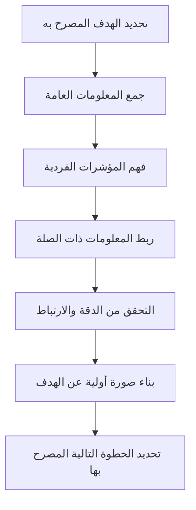

---

## 2. Start with Scope and Program Rules

قبل البحث عن معلومات تخص هدفًا في برنامج **Bug Bounty** أو مؤسسة معينة، اقرأ قواعد البرنامج ونطاقه (Scope). فالاستطلاع جزء من التقييم الأمني، ولذلك يجب أن يلتزم بحدود التصريح نفسها التي تحكم أي نشاط اختبار آخر.

راجع معلومات البرنامج بعناية وحدد ما يلي:

- **الأصول داخل النطاق (In-scope Assets):** النطاقات والتطبيقات والحسابات والأنظمة المحددة صراحةً ضمن الاختبار.
- **الأصول خارج النطاق (Out-of-scope Assets):** الأنظمة التي لا يجوز اختبارها أو التعامل معها باعتبارها أهدافًا للتقييم.
- **قواعد البرنامج (Program Rules):** القيود والأنشطة المحظورة وأي شروط خاصة.
- **تحديثات البرنامج وسجل التغييرات (Program Updates / Change Logs):** الإعلانات التي قد تغيّر النطاق أو القواعد.
- **متطلبات الاختبار الآمن (Safe-testing Expectations):** قد تكون الأنشطة التي تؤثر في توافر الخدمة أو المستخدمين أو البيانات مقيّدة.
- **قنوات التواصل (Communication Channels):** الوسائل المخصصة للإبلاغ عن المشكلات العاجلة أو طلب التوضيح.

لا تفترض أن أحد الأصول تابع للهدف لمجرد ظهوره في نتيجة بحث أو مستند أو مرجع شهادة رقمية أو ملف عام. فقد تستخدم المؤسسة مزودي خدمات خارجيين أو بنية تحتية مشتركة أو خدمات تديرها جهة أخرى. العلاقة الظاهرة بين أصلين تُعد **Lead** تحتاج إلى تحقق، وليست تصريحًا تلقائيًا باختبار الأصل.

السؤال المهم ليس فقط: «هل أستطيع العثور على هذا الأصل؟» بل أيضًا: «هل هذا الأصل موجود صراحةً داخل النطاق المصرح به؟ وما الأنشطة المسموح لي بتنفيذها عليه؟»

### Simple Workflow Diagram

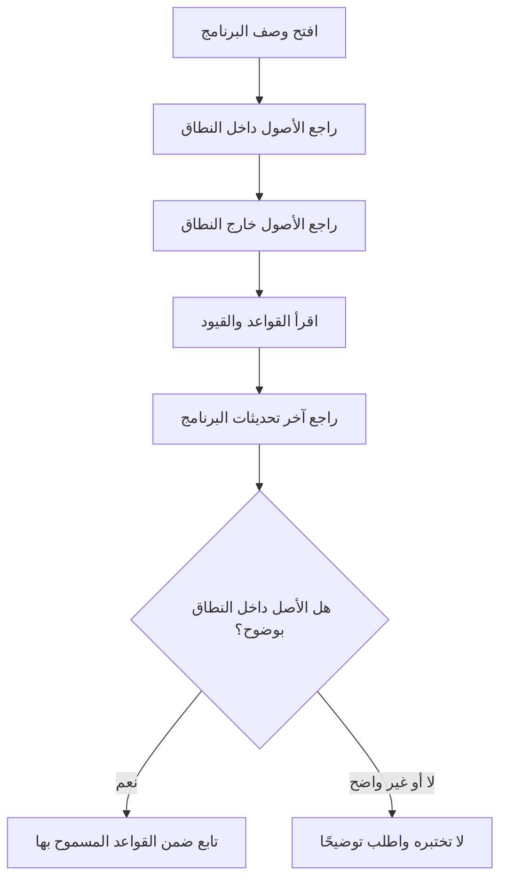

---

## 3. What Is Passive Reconnaissance?

**الاستطلاع السلبي (Passive Reconnaissance)** هو عملية جمع معلومات عن الهدف من مصادر عامة أو مصادر مسموح بها، دون إرسال حركة استطلاع مباشرة إلى أنظمة الهدف بهدف اكتشاف الأجهزة الحية (Live Hosts) أو المنافذ (Ports) أو الخدمات (Services) التي تستجيب.

من أمثلة المصادر السلبية التي يتناولها الدرس:

- محركات البحث (Search Engines).
- الشهادات الرقمية المتاحة للعامة والمعلومات المرتبطة بها.
- المستندات العامة (Public Documentation).
- مستودعات الشيفرات البرمجية العامة مثل **GitHub**.
- مصادر المعلومات العامة المرتبطة بـ **DNS**.
- خدمات أرشفة المواقع مثل **Wayback Machine** التابعة لـ **Internet Archive**.
- صفحات الشركات والمراجع التقنية المنشورة للعامة.

أما **الاستطلاع النشط (Active Reconnaissance)** فيختلف؛ لأنه يتضمن تفاعلًا مباشرًا مع أنظمة الهدف، مثل إرسال طلبات لاكتشاف الأجهزة التي يمكن الوصول إليها أو المنافذ المفتوحة أو الخدمات المستجيبة. وينتمي هذا النشاط إلى مرحلة منفصلة يجب أن تكون مصرحًا بها، وأن تلتزم بالنطاق والقواعد المعتمدة.

### The classification depends on the source and collection method

لا تصنّف الأداة على أنها Passive أو Active اعتمادًا على اسمها فقط. اسأل نفسك سؤالين:

1. من أين تأتي المعلومات؟
2. كيف يتم جمع هذه المعلومات؟

قد تستعلم الأداة من مصدر عام تابع لطرف ثالث في وضع معين، وقد تتفاعل مباشرةً مع الهدف في وضع آخر. لذلك فإن مصدر البيانات وطريقة الحصول عليها هما ما يحددان طبيعة النشاط.

### Simple Workflow Diagram

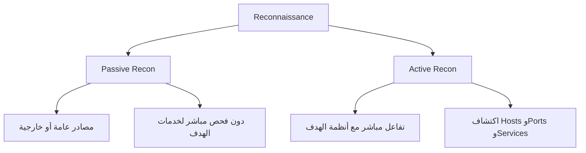

---

## 4. Think in Information, Not Tools

الفكرة الأساسية في هذا الدرس هي أن تحدد **ما المعلومات التي تحتاج إليها** قبل أن تختار الأداة.

تجنب البدء بقائمة من الأدوات وتشغيلها دون وجود سؤال محدد. بدلًا من ذلك، حدّد أولًا ما المعلومات الناقصة التي تريد الوصول إليها، ثم اختر المصدر والطريقة المناسبين للإجابة عن سؤالك.

أمثلة:

| السؤال | مصدر محتمل |
|---|---|
| ما النطاقات الأخرى التي قد تكون مرتبطة بالمؤسسة؟ | نتائج البحث العامة ومصادر المعلومات المرتبطة بالشهادات الرقمية |
| ما التقنيات أو المنتجات المذكورة للعامة؟ | المستندات العامة والصفحات التقنية ومحركات البحث |
| كيف كان شكل الموقع في الماضي؟ | أرشيف المواقع التاريخية |
| ما المستندات العامة التي نشرتها المؤسسة؟ | محركات البحث ومستودعات المستندات العامة |
| هل يكشف مستند عام معلومات إضافية عن الملف نفسه؟ | تحليل Metadata الخاصة بالمستند |
| هل تدعم جهة أخرى اسمًا أو Hostname ظهر أمامنا؟ | مصادر عامة مستقلة مع المقارنة والتحقق |

تكون الأداة مفيدة عندما تساعدك على الإجابة عن سؤال. بعد ذلك يجب أن تؤثر النتيجة في السؤال أو القرار التالي. أما إذا أنتجت الأداة مخرجات لا تستطيع تفسيرها أو ربطها بالتقييم، فقد لا تكون هذه المخرجات مفيدة.

### Simple Workflow Diagram

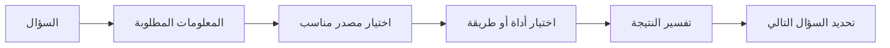

---

## 5. How Search Engines Work

تُعد **Search Engines** مصادر مهمة في الاستطلاع؛ لأنها قد تكشف صفحات ومستندات لا يعرف الباحث بوجودها.

يمكن تبسيط طريقة عمل محرك البحث إلى ثلاث مراحل رئيسية:

1. **Crawling:** اكتشاف الصفحات التي يستطيع محرك البحث الوصول إليها وزيارتها.
2. **Indexing:** معالجة المحتوى الذي تم اكتشافه وتخزين معلوماته داخل فهرس (Index).
3. **Retrieval and Ranking:** عندما يُدخل المستخدم استعلامًا، يسترجع المحرك العناصر المطابقة من الفهرس ويرتب النتائج وفق آلياته.

لا يبحث محرك البحث بالضرورة في كامل الإنترنت المباشر في اللحظة نفسها التي ترسل فيها الاستعلام. ففي كثير من الحالات، يبحث داخل المعلومات الموجودة بالفعل في الفهرس. ونتيجة لذلك:

- قد تكون الصفحة موجودة، لكنها لا تظهر في النتائج.
- قد تكون النتيجة قديمة أو لم تعد متاحة.
- قد تمتلك محركات البحث المختلفة فهارس وترتيبات مختلفة.
- ظهور النتيجة لا يثبت أن محتواها حديث أو مرتبط بالهدف المصرح به.

يمكن لمحركات البحث أن تقدم **Leads** مفيدة، لكن يجب مراجعة كل نتيجة مهمة والتحقق منها.

### Simple Workflow Diagram

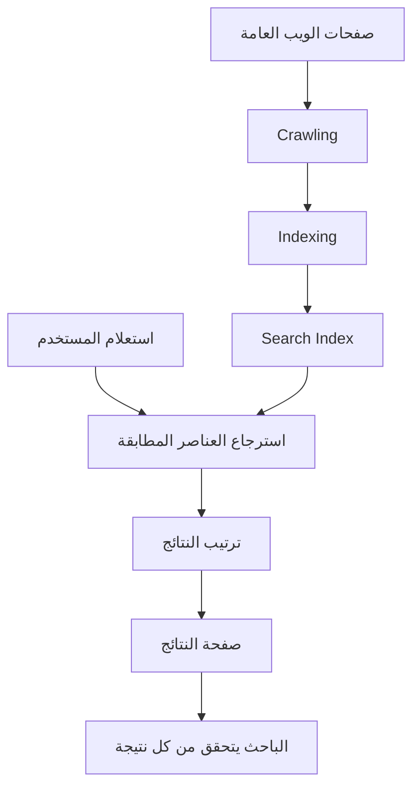

---

## 6. Search Operators for Targeted Research

قد يُظهر البحث العام عددًا كبيرًا من النتائج غير المحددة. تساعدك **Search Operators** على تضييق البحث ليشمل نطاقًا معينًا أو عبارة محددة أو عنوان صفحة أو نمط URL أو نوع ملف.

تستخدم الأمثلة التالية `example.com` كاسم افتراضي للتوضيح. استبدله فقط بأصل مصرح لك بإجراء البحث عنه صراحةً.

### 6.1 Restrict results to a domain with `site:`

```text
site:example.com
```

يطلب هذا الاستعلام من محرك البحث عرض النتائج المفهرسة المرتبطة بالنطاق المحدد. ويمكن استخدامه كبداية لاكتشاف الصفحات والمحتوى العام المفهرس.

### 6.2 Search for an exact phrase with quotation marks

```text
site:example.com "exact phrase"
```

تساعد علامات الاقتباس في البحث عن عبارة محددة، مثل اسم منتج أو مصطلح تقني أو رسالة خطأ مميزة.

### 6.3 Search for a particular file type with `filetype:`

```text
site:example.com filetype:pdf
```

يضيّق هذا الاستعلام النتائج إلى ملفات PDF المفهرسة والمرتبطة بالنطاق. ويمكن تطبيق الفكرة نفسها على أنواع أخرى تدعمها محركات البحث، مثل DOC وXLS وPPT.

### 6.4 Search page titles with `intitle:`

```text
site:example.com intitle:login
```

يركز هذا الاستعلام على الصفحات التي تحتوي عناوينها على الكلمة المحددة. وقد يساعد في اكتشاف صفحات Login مفهرسة للعامة، لكن النتيجة تظل مجرد Lead ولا تثبت وجود ثغرة.

### 6.5 Search URL content with `inurl:`

```text
site:example.com inurl:api
```

يبحث هذا الاستعلام عن عناوين URL التي تحتوي على النص المحدد. وقد يكشف صفحات أو مراجع تحتوي عناوينها على كلمات مثل `api`.

### 6.6 Combine search terms and Boolean logic

يمكن الجمع بين مصطلحات البحث للتعبير عن سؤال أكثر تحديدًا. على سبيل المثال، يسمح `OR` بالبحث عن أحد مصطلحين:

```text
site:example.com login OR authentication
```

قد يختلف السلوك الدقيق والصياغة المدعومة من محرك بحث إلى آخر. راجع توثيق محرك البحث نفسه عندما لا يعمل الاستعلام كما تتوقع.

### Search-operator reference

| المعامل أو الصياغة | الاستخدام | المثال |
|---|---|---|
| `site:` | حصر النتائج في نطاق | `site:example.com` |
| `"phrase"` | البحث عن عبارة مطابقة | `"product documentation"` |
| `filetype:` | البحث عن نوع ملف | `filetype:pdf` |
| `intitle:` | البحث داخل عنوان الصفحة | `intitle:login` |
| `inurl:` | البحث داخل URL | `inurl:api` |
| `OR` | البحث عن أحد عدة مصطلحات | `login OR authentication` |

لا تحفظ عددًا كبيرًا من الاستعلامات دون فهمها. ابنِ الاستعلام بناءً على المعلومة التي تحاول الوصول إليها.

### Simple Workflow Diagram

```mermaid
flowchart TD
    A[ابدأ بسؤال عام] --> B[اختر Search Operator]
    B --> C{ما الذي تريد تضييقه؟}
    C --> D[النطاق: site:]
    C --> E[العبارة: "..."]
    C --> F[نوع الملف: filetype:]
    C --> G[العنوان: intitle:]
    C --> H[الرابط: inurl:]
    D --> I[راجع النتائج]
    E --> I
    F --> I
    G --> I
    H --> I
    I --> J[سجّل المؤشرات المفيدة]
```

---

## 7. What Should You Search For?

تعتمد قيمة Search Query على السؤال الذي تقف خلفه. لا يهدف **Passive Reconnaissance** إلى جمع كل نتيجة يستطيع محرك البحث عرضها، بل إلى العثور على معلومات تساعد في فهم البصمة العامة للهدف.

### 7.1 Domains and related names

ابحث عن النطاق المعروف للمؤسسة وعن المراجع العامة ذات الصلة التي قد تكشف أسماء نطاقات أو Hostnames إضافية. سجّل مصدر كل مرجع، ولا تفترض أن كل نطاق يبدو مرتبطًا بالمؤسسة يقع تلقائيًا داخل النطاق المصرح به.

### 7.2 Public login and application pages

قد يساعدك العثور على صفحة Login في التعرف على تطبيق أو خدمة. لكن صفحة تسجيل الدخول ليست ثغرة بحد ذاتها؛ فقد تكون صفحة طبيعية محمية، أو صفحة قديمة، أو صفحة تديرها جهة خارجية.

### 7.3 API references and documentation

قد تكشف الوثائق العامة عن:

- أسماء المنتجات والخدمات.
- مصطلحات API والـ Endpoints الموثقة.
- إشارات إلى تقنيات معينة.
- Hostnames أو نطاقات ذات صلة.
- مصادر توثيق إضافية.

قد يقودك مرجع داخل Documentation إلى مصدر عام آخر. سجّل العلاقة بينهما بدلًا من اعتبار الاكتشاف مشكلة أمنية مؤكدة.

### 7.4 Products and technologies

إذا ذكر أحد المصادر منتجًا أو تقنية، يمكنك استخدام الاسم كمصطلح بحث جديد. وقد يساعدك ذلك في بناء **Technology Inventory** والعثور على مراجع عامة أخرى للمنتج نفسه.

لكن ذكر تقنية لا يثبت أن الهدف يستخدمها حاليًا في بيئة Production؛ فقد تكون مرتبطة بنظام قديم أو بيئة اختبار أو خدمة تابعة لطرف ثالث أو سياق غير مرتبط بالهدف الحالي.

### 7.5 Error messages and technical text

قد يكشف البحث عن رسائل خطأ مميزة أو عبارات تقنية صفحات عامة تتحدث عن Framework أو Product أو Service. تعامل مع النتائج بحذر؛ فرسالة الخطأ وحدها لا تكفي لإثبات قابلية الاستغلال أو التأثير الأمني.

### 7.6 Publicly indexed documents

قد تكشف المستندات العامة معلومات عن المنتجات والخدمات والتقنيات وأساليب التسمية وMetadata الخاصة بالملف. وتعتمد أهمية المستند على محتواه وسياق نشره وعمره ومدى ارتباطه بالهدف المصرح به.

### Simple Workflow Diagram

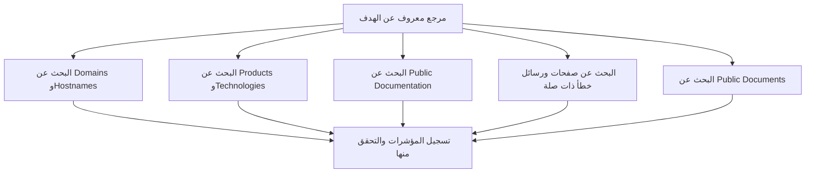

---

## 8. Build Queries as Hypotheses

تكون عملية البحث أكثر فاعلية عندما تكون تكرارية (Iterative). فالاستعلام عبارة عن سؤال أو فرضية، وليس مجرد أمر تنسخه وتنفذه.

يمكن اتباع الخطوات التالية:

1. ابدأ بمعلومة معروفة بالفعل عن الهدف.
2. اطرح سؤالًا محددًا حول جزء من المعلومات ما زال غير واضح.
3. أنشئ Query باستخدام مصطلحات ومعاملات البحث المناسبة.
4. راجع النتائج وحدد ما الذي توضحه بالفعل.
5. سجّل الـ Lead المفيد ومصدره.
6. استخدم المعلومة الجديدة لصياغة Query تالية.

### Example of an information pivot

افترض أن صفحة عامة تذكر منتجًا افتراضيًا اسمه `ExamplePortal`:

- الاستعلام الأول: ابحث في النطاق المصرح به عن اسم المنتج.
- مؤشر جديد: يظهر ملف PDF عام يحتوي على Documentation خاصة بالمنتج.
- الاستعلام التالي: ابحث عن اسم المنتج نفسه مع كلمة `documentation`.
- مؤشر جديد: يشير المستند إلى Hostname مرتبط بـ API.
- الخطوة التالية: سجّل الـ Hostname ومصدره والعلاقة المذكورة، ثم تحقق من وجوده داخل Scope المصرح به قبل التفكير في أي اختبار آخر.

الفكرة الأساسية هي تسلسل التفكير. قد تفتح معلومة جديدة سؤالًا أفضل، وقد يقودك السؤال إلى مصدر جديد.

### Simple Workflow Diagram

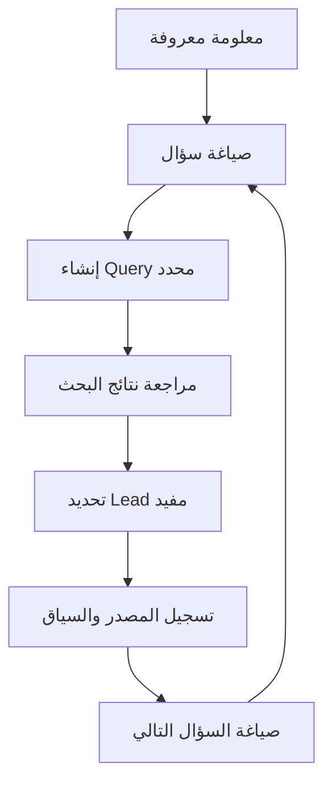

---

## 9. Use More Than One Search Engine

يتناول الدرس استخدام أكثر من محرك بحث، ومن الأمثلة المذكورة **Google** و**Bing** و**DuckDuckGo**.

قد تختلف محركات البحث في الفهارس (Indexes) ونطاق التغطية وطريقة ترتيب النتائج (Ranking). لذلك فإن عدم ظهور نتيجة في محرك واحد لا يثبت أن المعلومة غير موجودة؛ فقد تكون ببساطة غير موجودة في فهرس هذا المحرك أو لا تحتل ترتيبًا يسمح بظهورها.

من الأساليب المفيدة إعادة البحث المهم نفسه في أكثر من محرك، ثم مقارنة النتائج:

- النتائج المتطابقة من مصادر مستقلة قد ترفع مستوى الثقة.
- النتائج المختلفة قد تكشف مؤشرات إضافية.
- النتائج المتعارضة يجب التحقيق فيها بدلًا من تجاهلها.
- قد تكون نتائج البحث قديمة أو معاد توجيهها (Redirected) أو مكررة أو غير مرتبطة بالهدف.

انتبه إلى **Rate Limiting**. فقد تتلقى الأدوات الآلية التي ترسل طلبات متكررة إلى محركات البحث الخارجية استجابة HTTP `429 Too Many Requests`. لا يعني ذلك بالضرورة أن الأداة معطوبة؛ فقد يعني أن الخدمة تحدّ من عدد الطلبات. قلّل معدل الطلبات والتزم بشروط الاستخدام.

### Simple Workflow Diagram

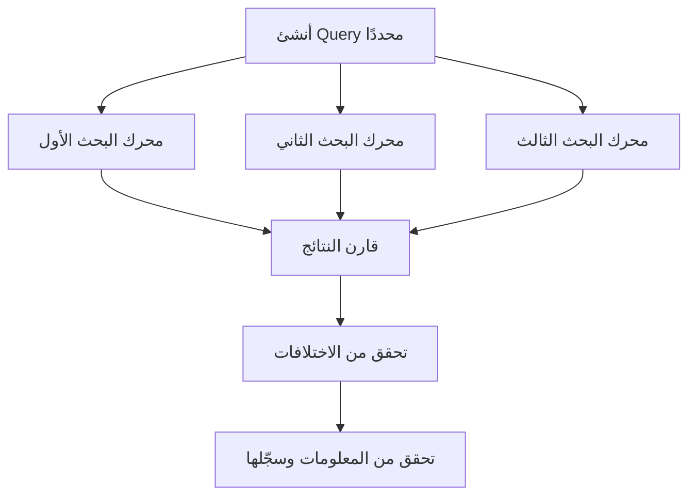

---

## 10. Validate Results: Leads Are Not Findings

من أهم الفروق التي يركز عليها الدرس هو الفرق بين **Lead** و**Confirmed Finding**.

الـ **Lead** هو مؤشر قد يكون مفيدًا لمزيد من البحث. ومن أمثلته:

- صفحة Login مفهرسة للعامة.
- Hostname تم العثور عليه داخل مستند.
- اسم تقنية مذكور في Documentation عامة.
- Username موجود في Metadata مستند.
- URL قديم تم العثور عليه في أرشيف تاريخي.

أما **Finding** فهو مشكلة أمنية تم التحقق منها وإثبات أن لها تأثيرًا أمنيًا حقيقيًا، وأنها تقع ضمن Scope وقواعد التقييم المتفق عليها.

نتيجة بحث أو Hostname أو Username أو اسم تقنية أو حقل Metadata لا يمثل ثغرة تلقائيًا.

### Questions to ask about every lead

1. **Authenticity — الموثوقية:** هل المعلومة حقيقية، وهل يعرضها المصدر بشكل دقيق؟
2. **Freshness — الحداثة:** هل المعلومة حديثة أم قد تكون تاريخية؟
3. **Relevance — الارتباط:** هل ترتبط بالفعل بالهدف؟
4. **Ownership — الملكية:** هل الأصل تابع للهدف أم لطرف ثالث؟
5. **Scope — النطاق:** هل الأصل مشمول صراحةً في التصريح؟
6. **Evidence — الدليل:** هل يمكن دعم الملاحظة أو العلاقة بمصدر موثوق؟
7. **Impact — التأثير:** هل تثبت المعلومة وجود ضعف أمني، أم أنها مجرد معلومة عامة؟

يشدد الدرس على أن كل معلومة لا يجب أن تُضاف إلى تقرير الثغرات. فبعض المعلومات مفيدة فقط لأنها تساعدك في تحديد ما يستحق البحث عنه بعد ذلك.

### Simple Workflow Diagram

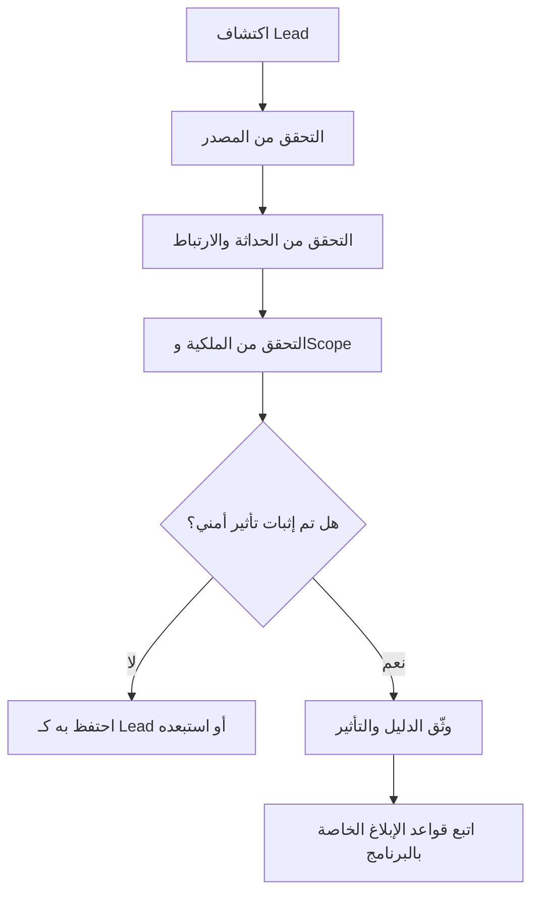

---

## 11. Document Reconnaissance as You Work

لا تعتمد على ذاكرتك ولا تؤجل تدوين الملاحظات إلى نهاية التقييم. فقد ينتج عن الاستطلاع عدد كبير من المؤشرات، ويصبح من الصعب بعد عدة ساعات أو أيام تذكّر مصدر المعلومة أو سبب أهميتها.

لكل معلومة مفيدة، سجّل ما يلي:

- المعلومة التي اكتشفتها.
- المصدر الذي عثرت عليها فيه.
- نوع المصدر أو البيانات.
- تاريخ جمع المعلومة.
- علاقتها بالهدف.
- سبب احتمال أهميتها.
- حالة التحقق الحالية.
- مستوى الثقة (Confidence Level).
- الخطوة المنطقية التالية.

لا يكفي حفظ الرابط وحده. أضف ملاحظة قصيرة تشرح ما يحتويه المصدر ولماذا احتفظت به.

### Example recon note

| الحقل | المثال |
|---|---|
| العنصر | `api.example.com` |
| المصدر | مستند PDF عام |
| النوع | مرجع إلى Hostname |
| الملاحظة | يذكر المستند هذا الـ Hostname ضمن مثال خاص بـ API |
| العلاقة بالهدف | قد يكون مرتبطًا بالمنتج الموثق للمؤسسة |
| الحالة | Lead غير متحقق منه |
| الثقة | متوسطة |
| الخطوة التالية | مقارنة مراجع عامة مستقلة والتأكد من Scope قبل أي اختبار |

استخدم تطبيق تدوين ملاحظات أو Spreadsheet أو ملفًا نصيًا منظمًا؛ المهم أن تتمكن من استرجاع المعلومة وفهمها لاحقًا.

### Simple Workflow Diagram

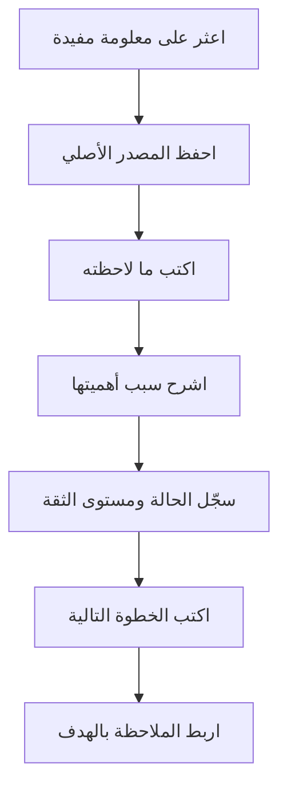

---

## 12. Public Documents and File Discovery

يمكن أن توفر المستندات العامة معلومات لا تظهر بوضوح في المحتوى المرئي للموقع. يركز الدرس على الملفات التي تم نشرها وإتاحتها للعامة من خلال مصادر مشروعة. الهدف هو فهم ما الذي تكشفه هذه الملفات، وليس الوصول إلى ملفات خاصة أو مقيّدة أو غير مخصصة للنشر العام.

من أنواع المستندات المحتملة:

- ملفات PDF.
- مستندات Word.
- جداول Excel.
- عروض PowerPoint.
- التقارير التقنية العامة ومستندات المنتجات.

قد يكشف المستند عن:

- أسماء المنتجات أو الخدمات.
- إشارات إلى تقنيات معينة.
- مراجع لوثائق API.
- Hostnames أو نطاقات.
- أساليب تسمية داخلية.
- مصادر عامة إضافية تستحق البحث.
- بيانات Metadata الخاصة بالملف والبرامج المستخدمة في إنشائه.

### A careful document-review process

1. ابحث فقط عن المستندات المفهرسة للعامة والمرتبطة بهدف مصرح به.
2. راجع عنوان كل نتيجة ونوع الملف وتاريخه الظاهر وسياقه.
3. حدّد ما إذا كان المستند مرتبطًا فعلًا بالهدف.
4. استخدم فقط المستندات المتاحة للعامة من خلال مصادر مسموح بها.
5. سجّل المصدر وسبب أهمية المستند المحتملة.
6. افحص Metadata عند الحاجة.
7. تحقق من أي Lead مهم باستخدام مصدر آخر.

لا تحاول تنزيل أو الوصول إلى ملفات مقيّدة، ولا تتجاوز Access Controls، ولا تفترض أن وجود رابط مكشوف يمنحك تصريحًا لاختبار النظام الذي يستضيف الملف.

### Simple Workflow Diagram

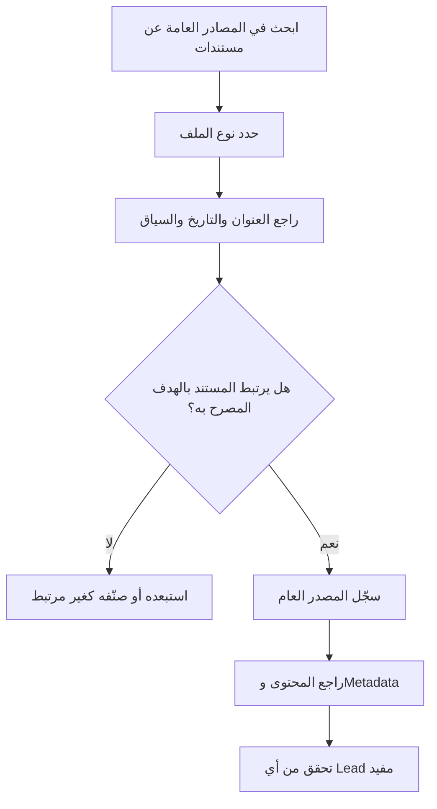

---

## 13. Understanding Document Metadata

**Metadata** هي معلومات تصف الملف نفسه، وهي تختلف عن المحتوى الظاهر المكتوب داخل المستند.

على سبيل المثال، قد يحتوي ملف PDF على تقرير أو دليل منتج ضمن المحتوى المرئي. لكن Metadata قد تحتوي على تفاصيل إضافية حول طريقة إنشاء الملف أو تعديله.

وفقًا لنوع الملف والطريقة التي أُنشئ بها، قد تتضمن Metadata ما يلي:

- اسم الملف ونوعه.
- حجم الملف.
- تاريخ الإنشاء وتاريخ التعديل.
- حقل Author أو Creator.
- البرنامج المستخدم في إنشاء الملف أو تعديله.
- أسماء أو Usernames تمت إضافتها إلى خصائص الملف.
- Internal Paths أو مراجع للمجلدات.
- Hostname أو إشارات مرتبطة بالبيئة.

### Metadata must be interpreted carefully

وجود اسم في حقل Author داخل الملف لا يعني تلقائيًا أنه موظف حالي. فقد يكون الاسم قيمة افتراضية أو اسم حساب قديم أو شخصًا أنشأ الملف على جهاز لم يعد مرتبطًا بالهدف.

وبالمثل، لا يعني وجود Internal Path أن هذا المسار يصف بنية Production الحالية. فقد يكون مسارًا تاريخيًا من الجهاز الذي استُخدم لإنشاء المستند.

الطريقة الصحيحة هي تسجيل الملاحظة والاحتفاظ بمصدر الملف، ثم مقارنة المؤشر بمعلومات مستقلة قبل استخلاص أي نتيجة.

### Metadata as a puzzle piece

تصبح قيمة Metadata أكثر فائدة عندما يمكن ربطها بمعلومات موثوقة أخرى. على سبيل المثال، يمكن مقارنة اسم Creator في مستند عام بملف شخصي عام أو بمصدر منشور آخر. يجب تسجيل العلاقة والأدلة ومستوى الثقة، وليس اعتبارها مؤكدة لمجرد تشابه نصين.

### Simple Workflow Diagram

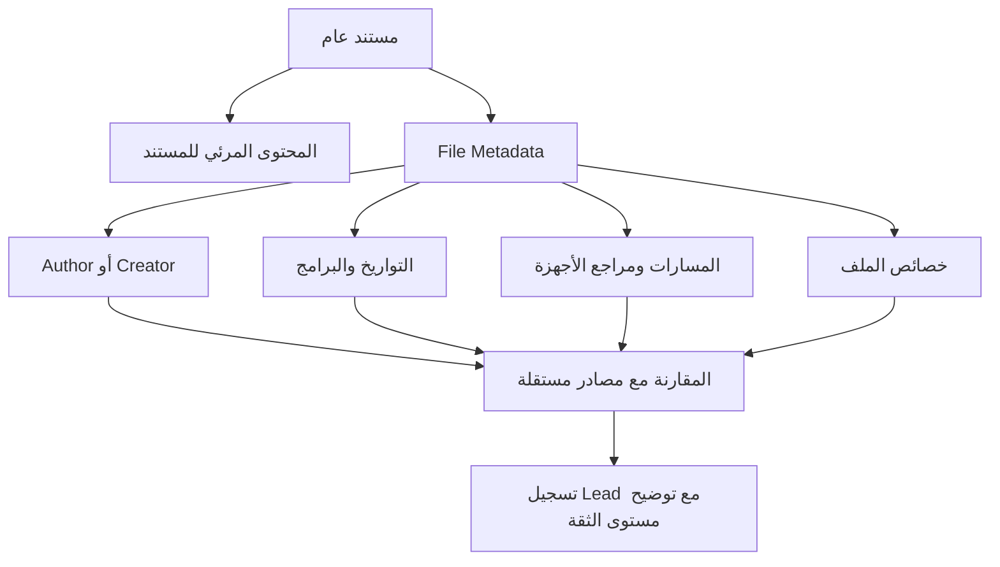

---

## 14. Using Metadata Tools and Automation

يعرض الدرس أدوات لتحليل Metadata بوصفها وسيلة لتسريع عملية ينبغي أن يكون الباحث قد فهمها بالفعل.

### ExifTool

يمكن لأداة **ExifTool** عرض Metadata من أنواع كثيرة من الملفات. مثال أساسي:

```bash
exiftool document.pdf
```

يجب مراجعة المخرجات حقلًا بحقل، بدلًا من التعامل معها على أنها قائمة Findings. حدّد القيم المرتبطة بسؤال البحث، وسجّل الملف المصدر، ثم تحقق من المؤشرات المهمة.

### FOCA

يتناول الدرس أيضًا أداة **FOCA** التي يمكن أن تساعد في اكتشاف المستندات العامة وتحليل Metadata الخاصة بها. قد تؤتمت الأداة أجزاءً من العملية، لكنها لا تحل محل فهم البيانات أو التحقق من النتائج.

يشير الشرح العملي إلى إعداد قديم نسبيًا لـ FOCA واعتمادها على قاعدة بيانات محلية من نوع SQL. وبما أن إصدارات الأدوات ومتطلباتها قد تتغير، تعامل مع تفاصيل الإعداد هذه على أنها مرتبطة بالإصدار المستخدم، وليست خطوات تثبيت عامة تصلح لكل الإصدارات. راجع توثيق الإصدار المحدد الذي ستستخدمه.

### Rate limiting and tool output

قد تتلقى أداة Metadata تستعلم من محرك بحث خارجي استجابة HTTP `429 Too Many Requests` إذا أرسلت عددًا كبيرًا من الطلبات خلال فترة قصيرة. هذا يمثل حدًا للطلبات من جهة الخدمة، وليس بالضرورة خللًا في الأداة. قلّل معدل الطلبات واحترم قواعد استخدام الخدمة.

### The right order

افهم المستند، ثم افهم حقول Metadata، ثم حدد القيم ذات الصلة، وبعد ذلك استخدم الأتمتة لتسريع العملية. لا تعكس هذا الترتيب.

### Simple Workflow Diagram

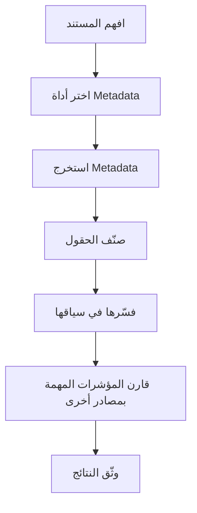

---

## 15. Connect the Clues into an Intelligence Picture

تزداد فائدة **Passive Reconnaissance** عندما تربط المعلومات ببعضها بدلًا من الاحتفاظ بنتائج البحث كعناصر منفصلة.

قد يكشف مستند عام عن اسم منتج. وقد يقودك اسم المنتج إلى مستند عام آخر. وربما يشير المستند الثاني إلى Hostname خاص بـ API. وقد يوفر مصدر متعلق بالشهادات الرقمية أو مرجع مستقل آخر سياقًا إضافيًا لهذا الـ Hostname.

وبالمثل، قد تكشف Metadata اسم Creator أو إصدار برنامج. ويمكن مقارنة هذه المؤشرات بمصادر عامة أخرى. كل مصدر إضافي قد يرفع مستوى الثقة في العلاقة أو يقلله.

### Example relationship chain

المثال التالي افتراضي لأغراض التعلّم:

```text
Public PDF
   |
   +--> اسم المنتج: ExamplePortal
             |
             +--> Public Product Documentation
                       |
                       +--> مرجع إلى API Hostname
                                 |
                                 +--> مرجع عام مستقل
```

في كل مرحلة، سجّل مصدر المعلومة. لا تعتبر العلاقة مؤكدة لمجرد أنها تبدو منطقية.

الهدف هو بناء صورة منظمة عن الهدف تساعد في توجيه العمل المصرح به لاحقًا، وليس جمع أكبر عدد ممكن من البيانات.

### Simple Workflow Diagram

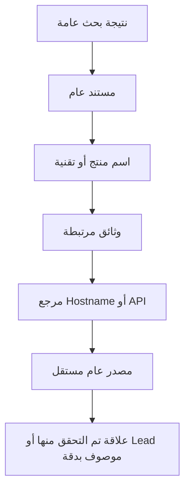

---

## 16. Practical Passive Reconnaissance Workflow

يجمع سير العمل التالي أفكار الدرس في عملية واحدة. وقد تم تنظيمه حول الأسئلة ومصادر المعلومات، وليس حول قائمة ثابتة من الأدوات.

### Step 1 — Confirm the authorized scope

اقرأ قواعد البرنامج، وحدد الأصول الموجودة داخل Scope، وافهم الاستثناءات، وراجع التحديثات.

### Step 2 — Build an initial target profile

سجّل اسم المؤسسة والنطاق المعروف وأي معرّفات أخرى مسموح باستخدامها كنقطة بداية للبحث في المصادر العامة.

### Step 3 — Choose the information question

قرر ما الذي تريد معرفته: نطاقات مرتبطة، أو أسماء منتجات، أو وثائق عامة، أو محتوى تاريخي، أو مؤشرات من Metadata.

### Step 4 — Select the best source

اختر المصدر بحسب السؤال. فمحركات البحث مفيدة للصفحات والملفات المفهرسة، والأرشيفات العامة مفيدة للمحتوى التاريخي، وأدوات Metadata مفيدة لفحص خصائص الملفات.

### Step 5 — Create and refine the query

استخدم مصطلحات دقيقة وSearch Operators مناسبة. وكرّر عمليات البحث المهمة في أكثر من محرك عند الحاجة.

### Step 6 — Review and validate results

تحقق مما إذا كانت كل نتيجة حديثة وذات صلة وحقيقية ومرتبطة بالهدف وداخل Scope. احتفظ بالعناصر غير المؤكدة باعتبارها Leads.

### Step 7 — Inspect public documents and metadata

عند العثور على مستند عام ذي صلة، راجع سياقه وMetadata. لا تصل إلى محتوى مقيّد ولا تتجاوز ضوابط الوصول.

### Step 8 — Connect related information

استخدم المعلومات الجديدة لصياغة أسئلة أفضل واكتشاف مصادر مستقلة مرتبطة.

### Step 9 — Document everything useful

سجّل العنصر والمصدر والملاحظة والعلاقة والحالة ومستوى الثقة والخطوة التالية.

### Step 10 — Prepare for the next authorized stage

لخّص ما أصبح معروفًا وما لا يزال غير مؤكد، وحدد الأصول التي تأكد وجودها داخل Scope. يجب أن يكون أي تفاعل مباشر أو Active Testing لاحقًا مسموحًا به بصورة مستقلة وفق قواعد البرنامج.

### Simple Workflow Diagram

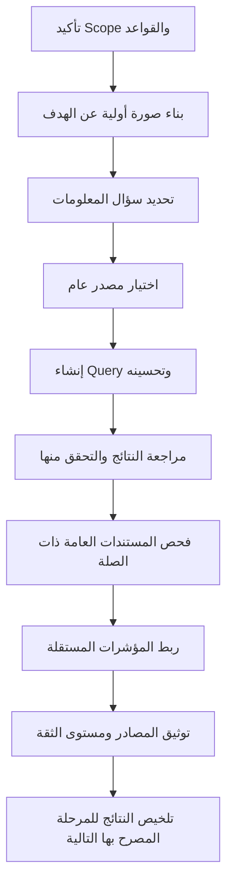

---

## 17. Field Notes Template

استخدم القالب التالي للحفاظ على تنظيم نتائج الاستطلاع. انسخ السجل لكل Lead مفيد.

```markdown
## Reconnaissance Record

- **العنصر / المعرّف (Item / Identifier):**
- **الهدف / الأصل المصرح به (Target / Authorized Asset):**
- **المصدر (Source):**
- **رابط المصدر (Source URL):**
- **تاريخ الجمع (Collection Date):**
- **نوع المعلومات (Information Type):**
- **الملاحظة (Observation):**
- **العلاقة بالهدف (Relationship to Target):**
- **الحالة الحالية (Current Status):** Unverified / Partially Verified / Verified / Rejected
- **مستوى الثقة (Confidence):** Low / Medium / High
- **سبب الأهمية (Why It Matters):**
- **التحقق الذي تم (Validation Performed):**
- **مراجعة النطاق (Scope Check):** In Scope / Out of Scope / Unclear
- **الخطوة التالية (Next Step):**
- **ملاحظات إضافية (Additional Notes):**
```

### Example record

```markdown
## Reconnaissance Record

- **العنصر / المعرّف:** api.example.com
- **الهدف / الأصل المصرح به:** example.com
- **المصدر:** مستند منتجات عام (Public Product Documentation)
- **رابط المصدر:** https://docs.example.com/sample-reference
- **تاريخ الجمع:** YYYY-MM-DD
- **نوع المعلومات:** مرجع إلى Hostname
- **الملاحظة:** يذكر المستند العام هذا الـ Hostname ضمن مثال خاص بـ API.
- **العلاقة بالهدف:** يبدو أن المستند يشرح منتجًا مرتبطًا بالمؤسسة.
- **الحالة الحالية:** Unverified
- **مستوى الثقة:** Medium
- **سبب الأهمية:** قد يساعد في توضيح البصمة العامة للتطبيق الموثق.
- **التحقق الذي تم:** تمت مقارنة المرجع بسياق المستند؛ ولم يتم تنفيذ أي اختبار مباشر.
- **مراجعة النطاق:** Unclear
- **الخطوة التالية:** تأكيد الملكية وScope من خلال معلومات البرنامج المصرح بها.
- **ملاحظات إضافية:** وجود مرجع عام لا يمنح تصريحًا تلقائيًا بالاختبار.
```

### Simple Workflow Diagram

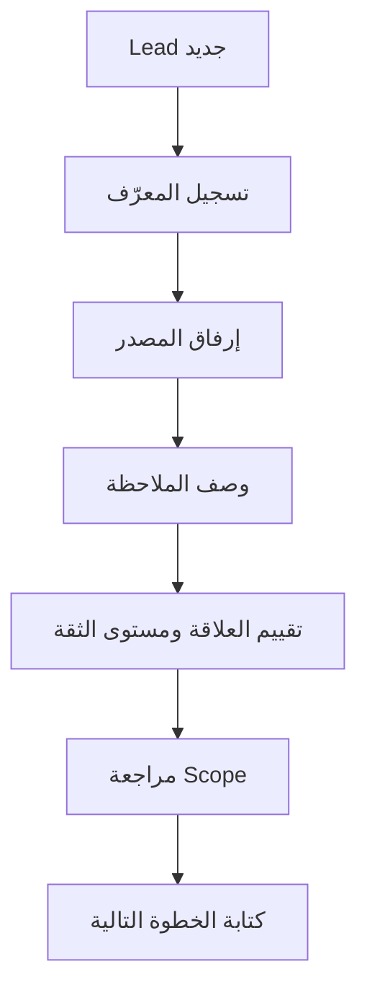

---

## 18. Final Checklist and Key Takeaways

### Before starting

- [ ] قرأت قواعد البرنامج وScope.
- [ ] أعرف الأصول الموجودة داخل Scope وخارجه.
- [ ] راجعت تحديثات البرنامج ذات الصلة.
- [ ] أفهم حدود النشاط الذي سأقوم به.

### During passive reconnaissance

- [ ] أبدأ بسؤال عن المعلومات المطلوبة، وليس بقائمة أدوات.
- [ ] أختار مصدرًا قادرًا على الإجابة عن السؤال.
- [ ] أستخدم Search Operators لتضييق الاستعلامات العامة.
- [ ] أقارن عمليات البحث المهمة عبر أكثر من محرك عند الحاجة.
- [ ] أراجع المستندات العامة في سياقها.
- [ ] أفسر Metadata بحذر.
- [ ] أميز بين المعلومات الحالية والمعلومات التاريخية.
- [ ] أسجل كل Lead مفيد مع مصدره الأصلي.
- [ ] أتابع مستوى الثقة وأتحقق من العلاقات المهمة.

### Before moving to another stage

- [ ] أعددت ملخصًا عن الهدف.
- [ ] فصلت المعلومات المؤكدة عن Leads غير المتحقق منها.
- [ ] راجعت الملكية وScope لكل أصل ذي صلة.
- [ ] وثّقت المعلومات التي ما زالت مجهولة.
- [ ] لن أنفذ Active Testing إلا إذا كان مصرحًا به صراحةً.

### Key takeaways

1. **Scope أولًا:** ظهور الأصل للعامة لا يعني وجود تصريح لاختباره.
2. **فكّر في المعلومات وليس الأدوات:** ابدأ بالسؤال الذي تريد الإجابة عنه.
3. **Passive Recon يعتمد على مصدر البيانات:** المصدر وطريقة الجمع أهم من اسم الأداة وحده.
4. **محركات البحث تعتمد على Indexes:** قد تكون نتائجها غير كاملة أو قديمة أو مختلفة من محرك لآخر.
5. **Search Operators تضيق نطاق السؤال:** استخدمها للبحث عن صفحات وعبارات وعناوين وروابط ومستندات محددة.
6. **Lead ليس Finding:** تحقق من الموثوقية والحداثة والارتباط والملكية وScope والتأثير.
7. **Metadata سياق وليست دليلًا قاطعًا:** يجب تفسير الأسماء والمسارات والتواريخ والبرامج والتحقق منها بمصادر أخرى.
8. **اربط المصادر المستقلة:** قد تقوي المراجع الموثوقة المتعددة العلاقة، لكن يجب تمييز الافتراضات بوضوح.
9. **وثّق أثناء العمل:** احتفظ بالمصادر والملاحظات ومستوى الثقة والخطوات التالية.
10. **استخدم الأتمتة لدعم الفهم:** قد تسرّع الأدوات الجمع والتحليل، لكنها لا تستبدل الحكم البشري.

### Final workflow summary

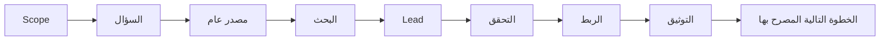

---

## Conclusion

الهدف من **Passive Reconnaissance** ليس جمع أكبر عدد ممكن من المعلومات، بل الوصول إلى معلومات مفيدة وفهم مصدرها وسياقها ومدى ارتباطها بالهدف.

ابدأ بتحديد Scope، ثم صغ سؤالًا واضحًا، واختر مصدر المعلومات المناسب، واستخدم Search Operators عند الحاجة، وراجع المستندات وMetadata، واربط المؤشرات بمصادر مستقلة، ثم وثّق كل خطوة ومستوى الثقة.

تذكّر أن **Lead لا يساوي Finding**، وأن ظهور معلومة للعامة لا يمنحك تصريحًا باختبار الأصل المرتبط بها. كل خطوة لاحقة يجب أن تظل داخل حدود التفويض وقواعد البرنامج.
